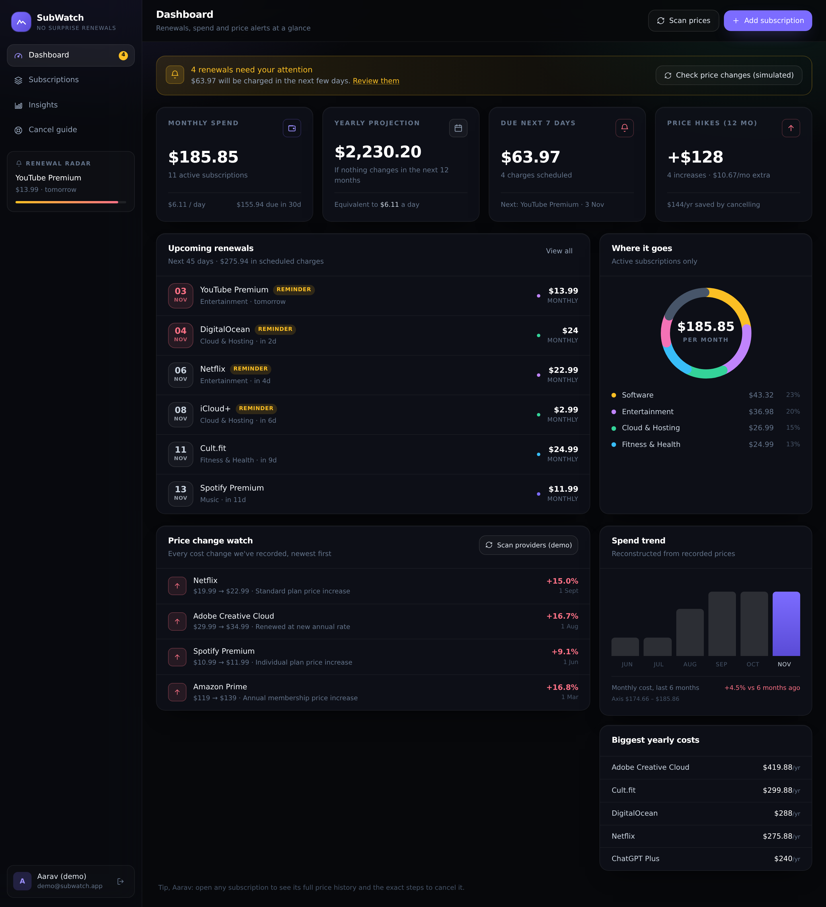
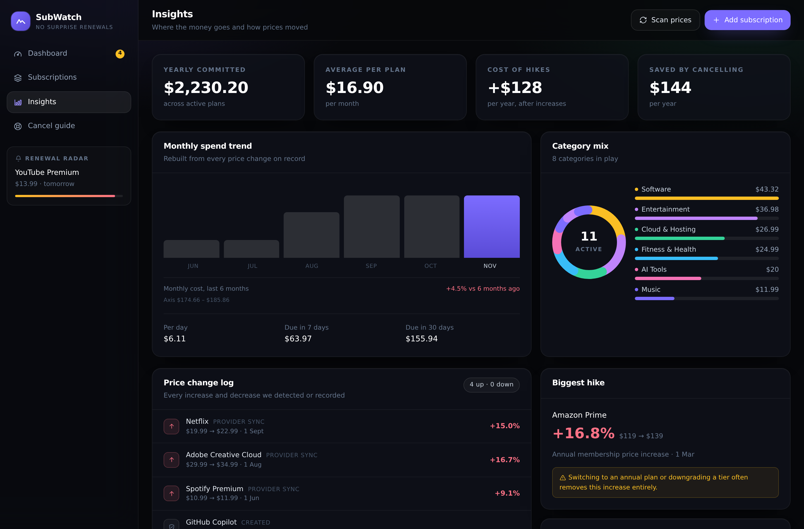
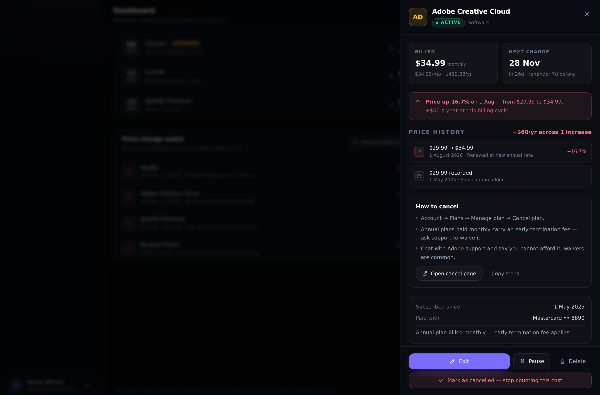
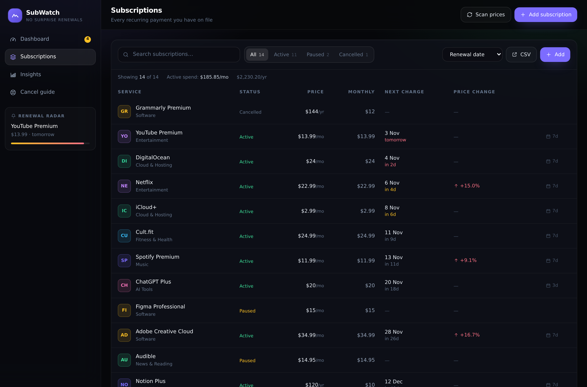
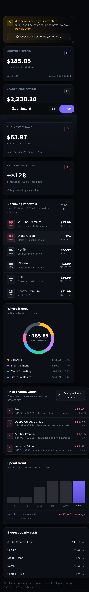

# SubWatch — Subscription & Price Increase Detector

A subscription management platform that helps users track recurring expenses, monitor price changes,
and avoid unwanted renewals.



## Live demo

- **Hosted preview (Arena session):** <https://4000-i1fpvjwkxjjdzr491lpod.e2b.app>
  — opens for the reviewer's authenticated session; it is protected by a sandbox traffic token, so it
  is not a public URL and may stop responding after the session ends.
- **Demo credentials:** `demo@subwatch.app` / `demo1234` (or press *“Explore the demo workspace”*).
- **Run it yourself in 60 seconds:** see [Quick start](#quick-start) or [Deploy your own](#deploy-your-own).

People subscribe to Netflix, Spotify, hosting, cloud storage and a dozen AI tools — then forget the
renewal dates and miss the quiet price increases. SubWatch puts every recurring payment in one place,
normalises the cost into a single monthly number, flags price hikes with the annual damage attached,
and tells you exactly how to cancel what you no longer use.

> **About the demo account:** it is seeded only when `SEED_DEMO=true` — on in development, **off by
> default in production**. The public Render demo opts in deliberately; never leave it on for a
> deployment holding real data. See [SECURITY.md](SECURITY.md).

---

## Features

| | Feature | Where |
|---|---|---|
| ✏️ | Manually add / edit / pause / cancel subscriptions | Subscriptions page, add modal |
| 💵 | Monthly + yearly totals with every billing cycle normalised | Dashboard KPIs, Insights |
| 🔔 | Renewal reminders per subscription (configurable lead time, in-app + API) | Dashboard alert strip, `GET /api/reminders` |
| 📈 | Price-change detection with full history and annualised impact | Price change watch, drawer, Insights |
| 🧾 | Total subscription spending, per-day cost, spend trend, category split | Dashboard, Insights |
| 🚪 | Cancellation instructions + direct cancel links for 35+ services | Cancel guide, subscription drawer |
| 👤 | Accounts with email + password, HttpOnly cookie sessions, CSRF protection, rate limiting | `server/auth.ts`, `server/security.ts` |
| 📤 | CSV export of everything you track | Subscriptions toolbar |
| 📱 | Responsive layout, mobile navigation | everywhere |

### Screenshots

| Insights | Price history drawer |
|---|---|
|  |  |

| Subscriptions | Mobile |
|---|---|
|  |  |

---

## Tech stack

- **React 19 + TypeScript + Vite** — typed SPA, hand-rolled SVG charts (no chart dependency)
- **Tailwind CSS 3** — design tokens, dark UI, responsive layout
- **Node.js + Express 5 + TypeScript** — REST API, Zod request validation
- **SQLite (better-sqlite3)** — zero-setup local database; schema is PostgreSQL-ready
- **bcrypt + JWT** — password hashing and stateless sessions

```
subwatch/
├── client/                 # React SPA
│   ├── src/
│   │   ├── components/     # AuthScreen, SubscriptionForm, DetailDrawer, charts, ui kit
│   │   ├── pages/          # Dashboard, Subscriptions, Insights, CancelGuide
│   │   └── lib/            # api client, types, formatting/cycle math
│   └── vite.config.ts      # dev server proxies /api → :4000
├── server/
│   ├── index.ts            # Express app + all routes
│   ├── service.ts          # subscription DTOs, renewal roll-forward, analytics
│   ├── catalog.ts          # cancel-guide catalogue (35+ services)
│   ├── seed.ts             # demo portfolio generator
│   ├── auth.ts             # bcrypt + JWT middleware
│   ├── db.ts               # SQLite driver + schema
│   └── util.ts             # billing-cycle math, currency, formatting
├── db/schema.postgres.sql  # PostgreSQL DDL for production
└── docs/screenshots/
```

---

## Quick start

```bash
# 1. API dependencies + client dependencies
npm install
npm --prefix client install

# 2a. Develop with hot reload (API :4000, Vite :5173 with /api proxy)
npm run dev

# 2b. Production-style run: compile the API + bundle the SPA, then serve both
#     from one process (this is what the Docker image and Render run)
npm run build        # tsc -p tsconfig.server.json && vite build (type-checks first)
npm run start:prod   # node dist-server/index.js  → http://localhost:4000
```

Environment (optional in development, see `.env.example`):

```bash
# Required in production — the server refuses to boot without a strong secret:
JWT_SECRET=$(node -e "console.log(require('crypto').randomBytes(48).toString('base64url'))")
PORT=4000
DATA_DIR=./data
TOKEN_TTL=12h
COOKIE_SECURE=true        # set automatically when NODE_ENV=production
SEED_DEMO=false           # demo account off unless explicitly enabled
PROVIDER_SYNC_SIMULATED=false
ALLOWED_ORIGINS=          # only needed if the SPA is hosted elsewhere
```

The SQLite file is created at `data/subwatch.db` on first boot, and the demo account is seeded
automatically. Nobody else's data is ever visible to a user — every query is scoped by `user_id`.

### Tests

```bash
npm test             # 19 tests: cycle math + security regression suite
npm run typecheck    # API + client, both mandatory (CI fails on type errors)
npm run build        # tsc --noEmit && vite build — no `|| true`, ever
```

`server/security.test.ts` boots the real Express app against a throwaway database and asserts over
HTTP: unauthenticated requests are 401 everywhere, cross-tenant IDOR attempts 404, CSRF-less writes
403, logout revokes tokens, forged-signature tokens are rejected, CSV formula injection is
neutralised, account deletion leaves no orphaned rows, security headers are present, login is rate
limited, oversized bodies are rejected, and a production boot without `JWT_SECRET` exits non-zero.

---

## Security

Full detail in [SECURITY.md](SECURITY.md); the short version:

- **Sessions:** JWT in an `HttpOnly`, `SameSite=Strict` cookie — never in `localStorage`, so an XSS
  payload cannot read it. CSRF double-submit token on every state-changing request. 12-hour lifetime
  with server-side revocation (`token_version`), bumped on logout and password change.
- **Secrets:** production **refuses to start** without a ≥32-character `JWT_SECRET`; placeholder
  strings are rejected. Development generates an ephemeral random secret per boot.
- **Authorization:** every record route resolves through an ownership guard (`user_id = session user`);
  cross-tenant IDs return 404. Covered by an IDOR regression test.
- **Abuse:** login limited to 10 attempts / 15 min per IP+email, registrations to 5/hour per IP,
  100 KB JSON body cap, closed-enum Zod validation on every payload, parameterised SQL only.
- **Browser hardening:** CSP, `nosniff`, `DENY` framing, `no-referrer`, HSTS in production, `no-store`
  on API responses, `X-Powered-By` removed, CORS headers only for explicitly allowed origins.
- **Data lifecycle:** password-confirmed account deletion removes the user, subscriptions and price
  history in one transaction (asserted in tests); CSV export neutralises spreadsheet formula
  injection.
- **Not done yet** (see SECURITY.md §7): email verification, password reset, MFA, real reminder
  delivery, real provider integrations, FX conversion, multi-instance rate limiting.

## How price-increase detection works

Every cost change is written to an append-only `price_changes` table — nothing is overwritten, so the
history is always auditable.

1. **Manual detection (always on).** When you edit a subscription's price (or its billing cycle), the
   API compares old vs new and logs an entry with `source = 'manual'`. The UI warns you before saving:
   *“Price change detected: $29.99 → $34.99 (+16.7%)”*.
2. **Provider feed (simulated — labelled as such in the UI and the response).** `POST /api/provider-sync` is the seam where a real integration goes —
   provider billing APIs, an open-banking feed, or an invoice-email parser. The demo implementation
   scans active subscriptions, and for a deterministic subset it applies a plausible 4–12% increase
   (once per subscription per month) with `source = 'provider-sync'`. Only increases are applied;
   a lower "market" price usually means a different plan, not a discount.
3. **Impact maths.** Each change is annualised — a $5 monthly increase is reported as **+$60/year** —
   so the dashboard can show what the hikes actually cost you over 12 months.

Because the baseline price is logged when a subscription is created, the drawer can always answer
*“what did this cost when I signed up?”*.

## Renewal reminders

> **What exists:** the reminder engine and API. **What does not:** email/push delivery — that needs a
> worker (cron + SMTP/SES/FCM) which is not part of this repo. The UI's in-app alerts are real; do not
> market this as an email reminder service until the worker ships.


Renewal dates roll forward automatically: if a date is in the past, the scheduler advances it by whole
billing cycles (with correct month-end clamping — Jan 31 + 1 month = Feb 28, weekly plans use day
arithmetic). Each subscription carries its own `reminder_days` lead time.

`GET /api/reminders` returns everything currently inside its reminder window, which is what a cron job
or email worker would poll:

```jsonc
{
  "count": 4,
  "due_in_next_7_days": 4,
  "total_amount": 63.97,
  "reminders": [
    { "subscription_id": 3, "name": "YouTube Premium", "amount": 13.99,
      "renews_on": "2026-11-03", "days_until": 1,
      "cancel_url": "https://www.youtube.com/paid_memberships" }
  ]
}
```

## Billing-cycle normalisation

| Cycle | Divisor to monthly | Yearly |
|---|---|---|
| Weekly | × 52 / 12 | monthly × 12 |
| Monthly | × 1 | × 12 |
| Quarterly | ÷ 3 | × 4 |
| Every 6 months | ÷ 6 | × 2 |
| Yearly | ÷ 12 | × 1 |

A `$99/year` plan therefore shows as `$8.25/month`, and a `$10/week` plan as `$43.33/month`.

---

## API reference

All subscription, analytics and catalog routes require `Authorization: Bearer <token>`, except the
public ones noted below.

| Method | Route | Description |
|---|---|---|
| `GET` | `/api/health` | Liveness probe (public) |
| `POST` | `/api/auth/register` | Create account → `{ token, user }` |
| `POST` | `/api/auth/login` | Sign in → `{ user }` (+ `token` when requested) |
| `GET` | `/api/auth/session` | Current user or `null` (never 401) |
| `POST` | `/api/auth/logout` | Revoke all sessions for the user, clear cookies |
| `GET` | `/api/auth/me` | Current user |
| `PATCH` | `/api/auth/me` | Update name / default currency |
| `GET` | `/api/meta` | Categories, cycles, currencies (public) |
| `GET` | `/api/subscriptions` | All subscriptions with derived fields |
| `POST` | `/api/subscriptions` | Create (auto-fills cancel guide + baseline price) |
| `PATCH` | `/api/subscriptions/:id` | Update; logs a price change when the cost changes |
| `DELETE` | `/api/subscriptions/:id` | Delete (cascades price history) |
| `GET` | `/api/subscriptions/:id/history` | Full price-change history |
| `GET` | `/api/analytics/summary` | Totals, categories, upcoming, alerts, price impact, trend |
| `GET` | `/api/reminders` | Subscriptions inside their reminder window |
| `POST` | `/api/provider-sync` | Run price-change detection |
| `GET` | `/api/catalog?q=` | Cancel-guide catalogue (public) |
| `GET` | `/api/export.csv` | CSV export |
| `POST` | `/api/demo/seed` | Load the demo portfolio into the current account |
| `DELETE` | `/api/account/data` | Wipe the current account's subscriptions |
| `DELETE` | `/api/account` | Delete the account, subscriptions and price history (password required) |

Example:

Browser clients use the HttpOnly session cookie. Scripts can opt into a bearer token with the
`X-Token-Response: 1` header (or `?token=1`):

```bash
TOKEN=$(curl -s -X POST localhost:4000/api/auth/login \
  -H 'Content-Type: application/json' -H 'X-Token-Response: 1' \
  -d '{"email":"demo@subwatch.app","password":"demo1234"}' | jq -r .token)

curl -s localhost:4000/api/subscriptions -H "Authorization: Bearer $TOKEN" | jq '.[0]'
curl -s -X POST localhost:4000/api/provider-sync -H "Authorization: Bearer $TOKEN"
```

Routes are listed below; `GET /api/auth/session` returns `{ user: null }` instead of a 401 so the SPA
can boot quietly.

---

## Data model

```
users ──< subscriptions ──< price_changes
```

- **users** — email (unique), name, bcrypt hash, default currency
- **subscriptions** — name, category, cost, currency, billing_cycle, next_renewal_date, started_on,
  status (`active` / `paused` / `cancelled`), payment_method, cancel_url, cancel_instructions, notes,
  reminder_days, cancelled_at
- **price_changes** — old_cost, new_cost, currency, billing_cycle, source
  (`created` / `manual` / `provider-sync` / `import`), note, changed_at

Deleting a subscription cascades to its price history.

## Moving to PostgreSQL

SQLite keeps the project runnable with no services to install; production should use PostgreSQL.

1. `psql -f db/schema.postgres.sql` (the DDL is already translated: `SERIAL`, `NUMERIC(12,2)`,
   `DATE`/`TIMESTAMPTZ`, `CHECK` constraints on enums).
2. Replace `server/db.ts` with a `pg` pool exposing the same tiny interface the routes use
   (`prepare(...).get/all/run`) — or port the ~15 queries in `index.ts` / `service.ts` to `$1`-style
   parameters, which is a mechanical change.
3. Point `DATABASE_URL` at the instance and set `JWT_SECRET` from the environment.

Nothing else in the codebase imports the database driver.

## Known limitations / roadmap

- **No FX conversion.** Each subscription keeps its own currency. Totals are computed **per currency**
  and never added across them: the dashboard shows the account's primary currency, Insights lists a
  per-currency breakdown, and the UI warns when more than one currency is in play.
- Renewal reminders are in-app; email/push delivery needs an SMTP or FCM worker polling
  `/api/reminders`.
- Provider sync is simulated. Real integrations (billing APIs, bank feeds, receipt parsing) plug into
  the same `recordPriceChange` path.
- Planned: shared/household accounts, budgets per category, annual-plan optimiser, trial tracking,
  import from bank CSV/statement.

## Deploy your own

**Render (fastest, free tier):** the repo contains a [`render.yaml`](render.yaml) blueprint.

1. Push this repo to GitHub (see [GITHUB-UPLOAD.md](GITHUB-UPLOAD.md)).
2. In Render: **New → Blueprint**, pick the repo, apply. `JWT_SECRET` is generated for you.
3. The blueprint sets `SEED_DEMO=true` so the public demo account works. Flip it to `false` before
   real users are involved.
4. Free-plan disks are ephemeral: the SQLite file resets on redeploy. Attach a persistent disk, or
   move to PostgreSQL, for anything you care about.

**Docker:**

```bash
docker build -t subwatch .
docker run -p 4000:4000 \
  -e JWT_SECRET="$(openssl rand -base64 48)" \
  -e SEED_DEMO=true \
  -v subwatch-data:/data \
  subwatch
```

**Any Node host (Railway, Fly, a VPS):**

```bash
npm ci && npm --prefix client ci
npm run build          # compiles the API and bundles the SPA
JWT_SECRET=<32+ random chars> NODE_ENV=production npm run start:prod
```

Serve it behind HTTPS (Fly/Vercel/Render terminate TLS for you) so `COOKIE_SECURE=true` cookies —
the default in production — are accepted by browsers.

## Production checklist

Before pointing real users at this:

- [x] Mandatory type-checking in the build and in CI (`.github/workflows/ci.yml`)
- [x] Fail-fast startup without a strong `JWT_SECRET`
- [x] Demo account gated behind `SEED_DEMO`, off by default in production
- [x] HttpOnly cookie sessions, CSRF protection, revocation, login rate limiting
- [x] Ownership checks on every record route, with regression tests
- [x] Security headers, body limits, safe error responses, structured request logs
- [x] Account deletion that removes all related rows
- [ ] PostgreSQL migration (`db/schema.postgres.sql`), migrations + tested backups/restores
- [ ] Email verification, password reset, MFA
- [ ] Real reminder delivery worker and a real provider/billing integration
- [ ] Reverse proxy with TLS, secret manager, monitoring/alerting, error tracking
- [ ] Privacy policy, terms of service, data-retention policy

## License

MIT
